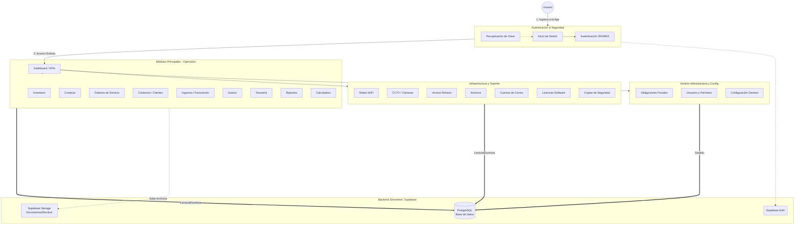
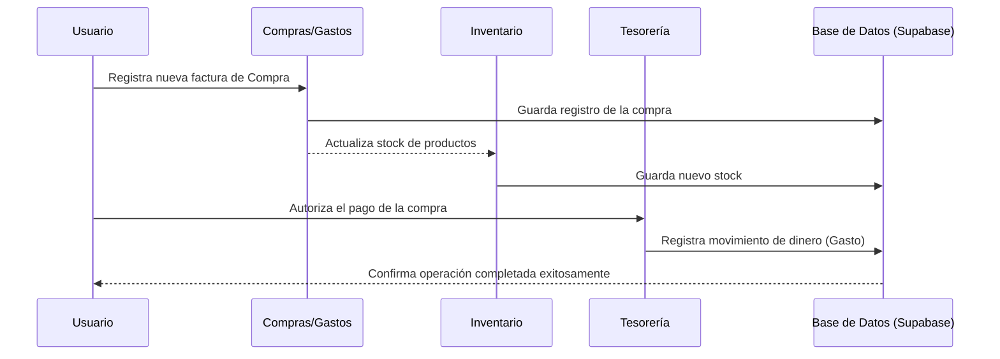

# Diagrama de Procesos y Arquitectura - Contable PWA

Este documento ilustra la estructura general y los flujos principales de la aplicación Contable PWA.

## Arquitectura General y Flujo de Interacción

El siguiente diagrama muestra cómo interactúa el usuario (Actor) con los diferentes módulos y cómo estos se conectan con el backend (Supabase).

## Flujo de Proceso Operativo Típico

Este diagrama detalla un flujo de proceso estándar (ej. Compra a Inventario y Pago).

## Módulos y Agrupación Lógica (Menú)

1. **Principal:**
   * Dashboard, Inventario, Compras, Órdenes de Servicio, Contactos, Ingresos, Gastos, Tesorería, Reportes, Calculadora, Usuarios, Configuración.
2. **Infraestructura y Soporte (IT):**
   * Redes WiFi, CCTV, Acceso Remoto, Antivirus, Correos, Licencias, Backups.
3. **Gestión Administrativa:**
   * Obligaciones (Vencimientos fiscales).
